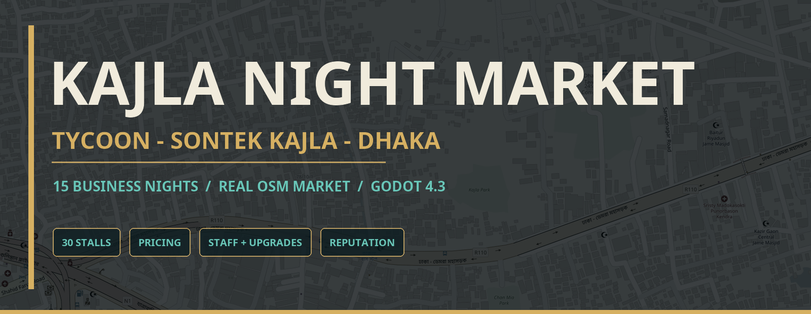
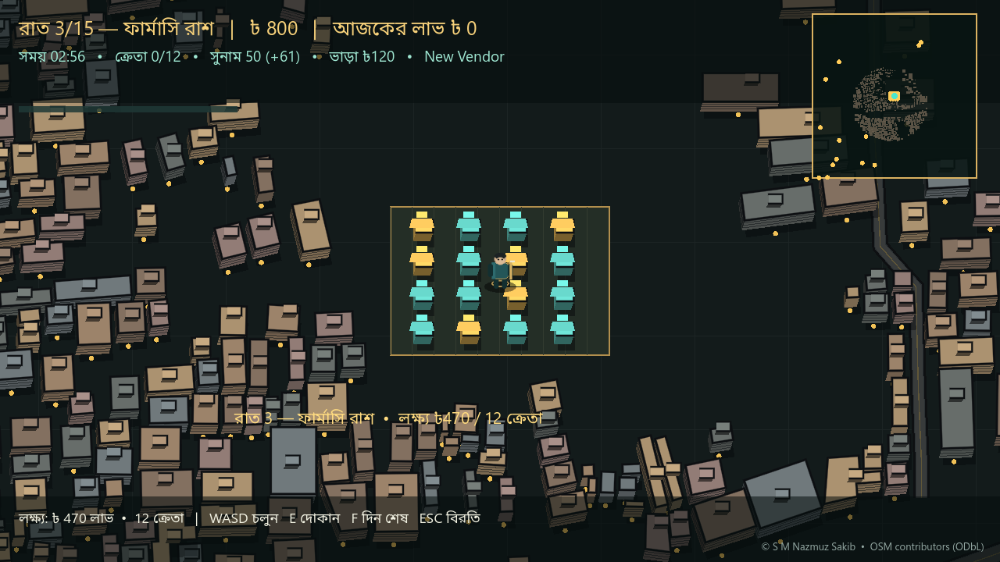
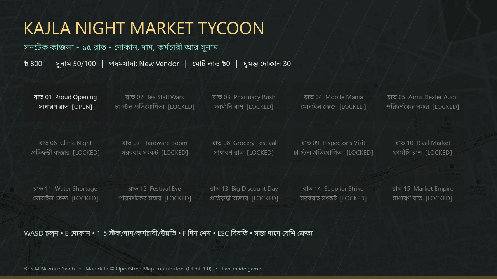
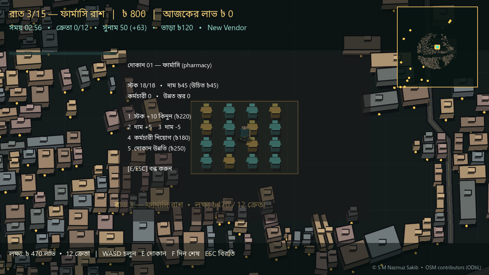
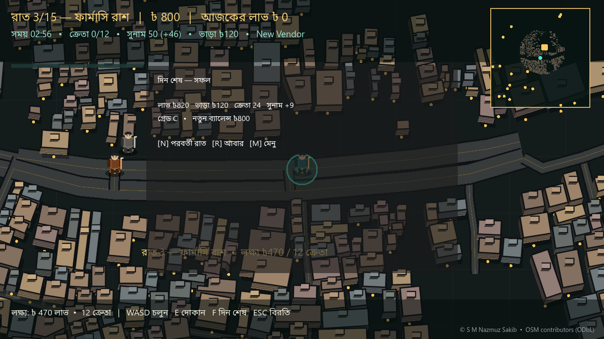
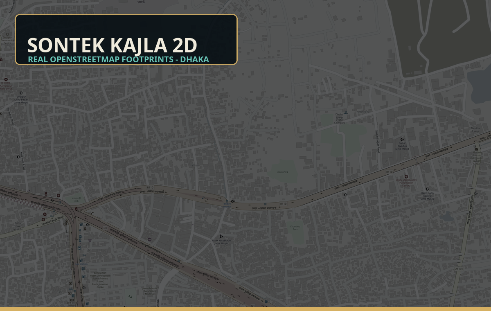
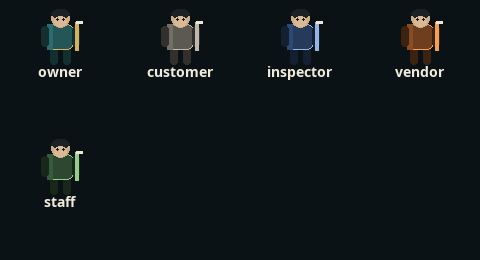

# Kajla Night Market Tycoon

[](https://github.com/Sakibpedia/kajla-night-market-tycoon/actions/workflows/build_exes.yml)



A **2.5D night-market business simulation** built in the real Sontek Kajla neighbourhood of Dhaka. This is a complete genre change from the stealth games: run stalls, set prices, hire staff, keep customers happy and grow a market empire across 15 nights. Godot 4.3.



## Play

Download `KajlaNightMarket.exe` from the [Releases page](https://github.com/Sakibpedia/kajla-night-market-tycoon/releases) and double-click it. SmartScreen: **More info → Run anyway** (unsigned build).

## Gameplay

- **46 stalls** from 30 OSM roadside shops plus a 16-stall market plaza, each with its own stock, price, staff and upgrade level.
- **Customers** walk the market and buy from stalls. They prefer fair prices: overpricing loses sales and reputation; cheap goods bring repeat customers.
- **Management panel** (`E` at a stall): buy stock, adjust price, hire staff and upgrade capacity. Staff generate passive sales.
- **Inspectors** fine stalls charging far above fair price. Reputation affects demand.
- **15 business nights** with escalating profit/customer targets, rent and events (tea-stall wars, pharmacy rush, supplier shortage, rival market…).
- End a night early with `F` once targets are met, or wait for the clock. Grades A/B/C, medals, unlocks, wallet and stall state persist in `user://kajla_night_market.cfg`.

## Screenshots (real rendered frames)

| Menu | Market plaza | Stall management |
|---|---|---|
|  |  |  |

| Night summary | Source OSM map | Character sprites |
|---|---|---|
|  |  |  |

## Controls

```
WASD / arrows  walk       Shift sprint      E manage stall
1 buy +10 stock   2 price +5   3 price -5   4 hire staff   5 upgrade stall
F end night        ESC pause/close panel
Menu: R retry night, N next night, M main menu
```

## Repository layout

```
project.godot                 Godot 4.3 project
assets/maps/kajla.json        6,481 real OSM footprints + 341 roads (ODbL)
assets/sprites/               Locally generated 2.5D characters and art
scripts/autoload/Game.gd      Nights, wallet, reputation, stall data, saves
scripts/world/City2D.gd       Extruded 2.5D OSM city + market plaza
scripts/world/MarketDay.gd    Customers, sales, staff, inspectors, night loop
scripts/ui/TycoonHUD.gd       Business HUD, management and summary panels
tools/make_visuals.py         Regenerates all art and README images
tools/test/                   Headless suites for city, economy and all 15 nights
```

## Build and test

```powershell
godot --headless --path . --import
python tools/make_visuals.py
godot --headless --path . res://tools/test/CityTest.tscn
godot --headless --path . res://tools/test/EconomyTest.tscn
powershell tools/test/run_all.ps1 -Godot "C:\path\to\Godot_v4.3-stable_win64_console.exe"
godot --headless --path . --export-release "Windows Desktop"
```

Every suite prints `PASS`. Results: [docs/VERIFICATION.md](docs/VERIFICATION.md).

## Credits

Game design, code and generated art: **S M Nazmuz Sakib**.
Map data © [OpenStreetMap contributors](https://www.openstreetmap.org/copyright), ODbL 1.0.
Fonts: Noto Sans / Noto Sans Bengali (SIL OFL 1.1).
Made by S M Nazmuz Sakib. No open-source license is granted for the original work.
